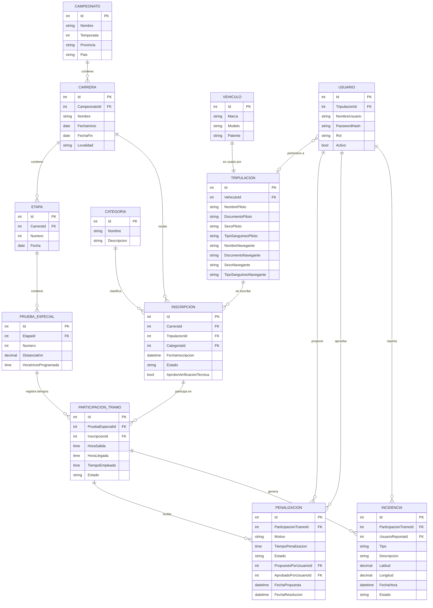
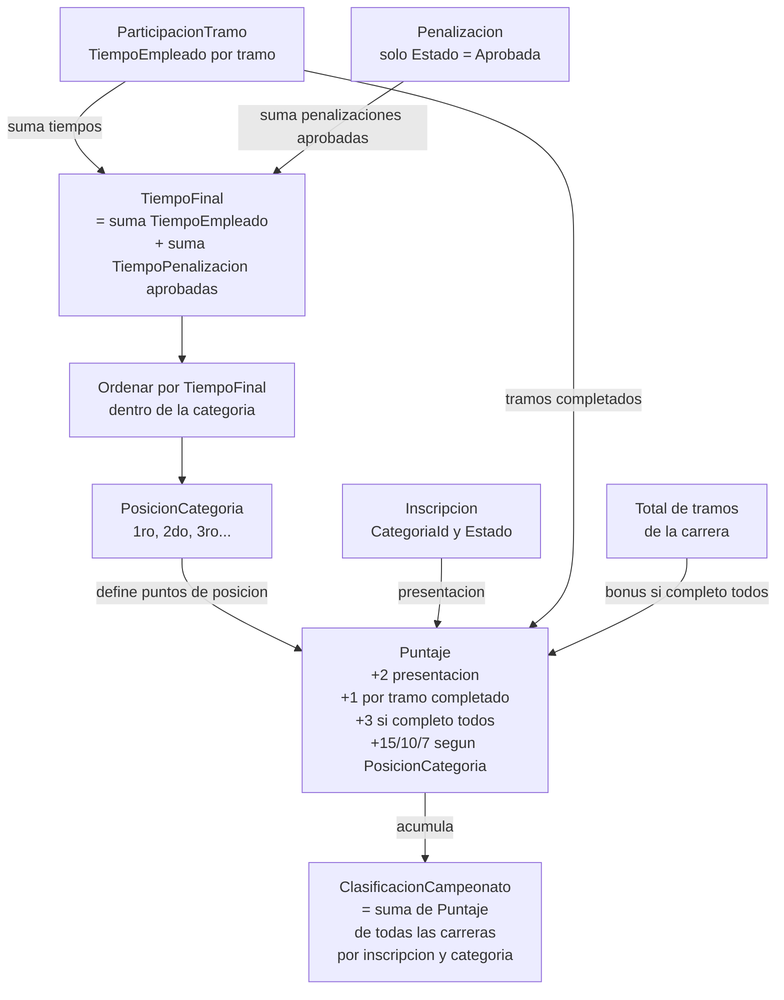

# Modelo de RallyManager

Documento de referencia del modelo de dominio. Se divide en dos partes:

1. **DER de persistencia**: tablas que se guardan en la base de datos.
2. **Cadena de cálculo**: datos derivados que NO se persisten y se calculan en la capa Application.

## 1. DER de persistencia

Solo entidades persistidas, con sus claves foráneas reales.

## 2. Cadena de calculo (datos derivados)

Las entidades de esta cadena **no se persisten**. Se calculan en la capa Application a partir de los datos persistidos.

- `TiempoFinal`: suma de `TiempoEmpleado` + penalizaciones **aprobadas**, por inscripción y carrera.
- `PosicionCategoria`: orden de `TiempoFinal` dentro de la categoría, por carrera.
- `Puntaje`: puntos por participación, tramos completados, bonus y posición, por inscripción y carrera.
- `ClasificacionCampeonato`: suma de `Puntaje` de todas las carreras, por inscripción y categoría.

## 3. Reglas de puntaje

| Concepto | Puntos |
|---|---|
| Presentacion a la carrera | 2 |
| Por tramo completado | 1 |
| Bonus por completar todos los tramos | 3 |
| 1er puesto de categoria | 15 |
| 2do puesto de categoria | 10 |
| 3er puesto de categoria | 7 |

Criterios:
- Un abandono suma presentacion y los tramos completados, pero no el bonus.
- Los puntos de posicion solo se otorgan a quien completo al menos un tramo.
- La tabla de puntos es configurable (capa Application), no esta hardcodeada en las entidades.